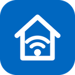

# Housecast

Housecast plays whatever your Windows PC is playing on AirPlay 2 speakers: one speaker, or several at once in sync. It lives in the tray. Click its icon, tick the speakers, and the sound plays there.

It works with AirPlay speakers on its own: no Mac, iPhone, extra box or bridge software.

## Features

- **Any sound from the PC:** music, video, games and calls, whatever Windows plays on its default output.
- **Several speakers in sync**, started together or added while playing.
- **Groups:** name a set of speakers and play them all with one tick.
- **Groups on your iPhone and iPad:** each group also appears in their AirPlay list as one speaker. Play to it, and all its speakers play together, in sync with the device.
- **Per-speaker volume and delay**, plus one volume for all of them. Delay changes apply while playing.
- **Remembers your speakers** and plays them again when Housecast starts.
- **Mutes the PC's own speakers** if you want, since they play ahead of the AirPlay ones.
- Follows Windows' light or dark mode and your accent colour.

## Installing

1. Download `Housecast-<version>-x64-setup.exe` from [Releases](https://github.com/sherri55/housecast/releases). Use the `arm64` installer on Windows on ARM.
2. Run it. The installer isn't code-signed yet, so Windows SmartScreen may warn: choose **More info**, then **Run anyway**.
3. Housecast starts in the tray. Click its icon to pick speakers.

The installer asks for administrator rights so it can add a Windows Firewall rule that lets your speakers answer Housecast, and lets iPhones and iPads reach your groups. Without it, speakers connect but play nothing, and groups don't connect from other devices.

**Requirements**

- Windows 10 or 11, x64 or ARM64.
- Speakers that support AirPlay 2. Original AirPlay (AirPlay 1) devices aren't supported.
- The PC and speakers on the same network, with Windows set to treat it as a **Private** network (Settings → Network & internet → your connection → Private network).
- No other AirPlay sender running on the same PC: Housecast needs UDP ports 319 and 320.

## Using it

Click the tray icon to open the flyout. The header shows where the sound is playing and has one volume slider for every speaker. Below it: **This PC**, your **Groups**, and the **Speakers** Housecast has found, each with an icon for the kind of device and its model.

| Control | What it does |
|---|---|
| Speaker | Tick to play on it, untick to stop. A ticked speaker opens into a card with its **Volume** and **Delay**. |
| Volume | That speaker's volume, remembered between runs. Some TVs ignore it and use their own remote's volume instead. |
| Delay | Plays that speaker earlier or later, in 100 ms steps, within ±2 seconds. Use it to line up speakers that sound out of step, or to match a video. |
| Group | Tick to play on all its speakers; untick to stop them. The **New group** row below the list creates one; the pencil on a group, or right-clicking it, edits or deletes it. |
| This PC | Untick to mute the PC's own speakers while AirPlay plays. Quitting puts the mute back as it was. |
| Volume (header) | Scales every speaker's volume at once. |

Each slider has − and + buttons (hold to repeat). Right-click the tray icon for **Start with Windows**, **Restart**, **Uninstall Housecast** and **Quit**. Quitting stops the speakers.

**Playing to a group from an iPhone or iPad.** Every group you make shows up in their AirPlay list under its own name, while Housecast runs. Pick it and play: the group's speakers stop playing the PC's sound, play the device's instead, in sync with it (video included), and go back to the PC's sound when it stops. The device's volume scales each speaker's own, and the flyout's header shows which device is playing. Macs list groups too, but playing from a Mac is untested, and its whole system sound isn't supported. Two things to expect:

- About half a second of silence each time you press play, resume, skip or seek. The device asks for its sound to be heard the moment it sends it, and the first moments can't reach the speakers in time.
- The device shows a group with the same plain speaker icon as any other non-Apple speaker; iOS chooses that icon itself.

**Pairing with a PIN.** Most speakers play straight away. A device that asks for pairing shows a PIN on its screen, and Housecast shows a PIN box under it: type the PIN and press **Pair**. Housecast remembers the pairing.

**Video.** AirPlay speakers play about two seconds after they receive the sound, and Housecast takes back as much of that as each speaker's Delay allows. A speaker at −2000 ms delay still plays a fraction of a second behind the picture, so for video, set the player to delay its picture slightly. In VLC: *Tools → Track Synchronization → Audio track synchronization*.

## Troubleshooting

- **"Another program is using the network ports Housecast needs"**: another AirPlay sender on this PC is using UDP 319 and 320. Close it and start Housecast again.
- **A speaker ticks but plays nothing**: check the network is set to Private, and that the installer's firewall rule exists: `Get-NetFirewallRule -DisplayName Housecast`.
- **No speakers listed**: the PC and speakers must be on the same network, and the speakers must support AirPlay 2.
- **A speaker unticks itself**: it stopped answering, or another device started playing on it.
- **A group isn't in the iPhone's AirPlay list**: Housecast must be running, the device on the same network, and Windows set to Private. If it's listed but won't connect, check the firewall rule as above.

## Building from source

Needs the .NET 10 SDK; the installer also needs [Inno Setup 6](https://jrsoftware.org/isinfo.php) (`winget install JRSoftware.InnoSetup`).

```powershell
dotnet build Housecast.slnx                # build everything
dotnet test tests\AirPlay.Engine.Tests     # unit tests
.\build.ps1 -Version 1.0.0 -Arch x64       # self-contained app and installer, into dist\
```

Pushing a tag such as `v1.0.0` runs the same build on GitHub Actions and attaches the x64 and arm64 installers to a release.

| Folder | What's in it |
|---|---|
| `src/Housecast` | The WPF tray app: capture, flyout, settings. |
| `src/AirPlay.Engine` | The AirPlay 2 sender: discovery (Windows DNS-SD), HomeKit pairing, RTSP sessions, the PTP clock master that keeps speakers in sync, encrypted RTP audio, and pacing. Also the AirPlay 2 receiver that announces groups (`Receiver/`) and relays what devices play to them. |
| `tests/AirPlay.Engine.Tests` | xUnit tests, including PTP messages checked byte for byte against a working sender. |
| `tools/EngineSpike` | A console app for trying the engine on real speakers: `dotnet run --project tools\EngineSpike -- tone "Speaker name"`, or `relay "Group name" "Speaker 1,Speaker 2"` to try a group from an iPhone. |
| `installer` | The Inno Setup script. |

## How it works

Housecast captures the PC's sound with WASAPI loopback and converts it to 44.1 kHz 16-bit stereo. Its engine is a C# port of the AirPlay 2 sender in [OwnTone](https://github.com/owntone/owntone-server). It pairs with each speaker, acts as the PTP clock every speaker follows, and sends the audio as encrypted ALAC packets on one shared timeline. That shared clock and timeline are what keep several speakers in sync.

For groups, Housecast is also an AirPlay 2 receiver, following [Shairport Sync](https://github.com/mikebrady/shairport-sync). Each group is announced as a speaker of its own. When a device plays to it, Housecast follows the device's PTP clock, decodes its AAC audio with Windows' own decoder, and sends it on to the group's speakers on a stream of their own, timed to play when the device asked.

## Licence

GNU General Public License, version 2 or later: see [LICENSE](LICENSE). Housecast includes code ported from OwnTone and other projects; see [NOTICE](NOTICE) for their credits and licences.

AirPlay is a trademark of Apple Inc. Housecast is not affiliated with or endorsed by Apple.
